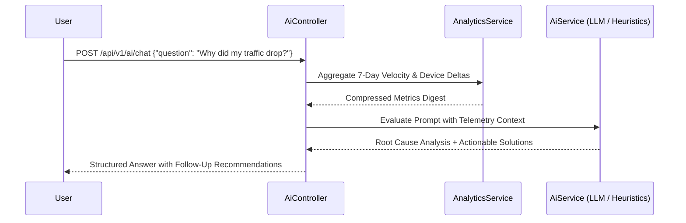

# Base62 AI — Intelligent URL Management & High-Throughput Analytics Platform

[](https://openjdk.org/projects/jdk/21/)
[](https://spring.io/projects/spring-boot)
[](https://react.dev/)
[](https://www.docker.com/)
[](LICENSE)

**Base62 AI** is a production-style, highly scalable URL shortening and telemetry platform engineered to demonstrate core distributed systems patterns: **Base62 bijective encoding with non-sequential obfuscation**, **sub-millisecond Redis redirection caching**, **sliding-window distributed rate limiting**, **decoupled asynchronous analytics pipelines**, and an **LLM-driven performance diagnostics engine**.

---

## 📌 Architecture Overview

```
                                  +-------------------+
                                  |   Web & API User  |
                                  +---------+---------+
                                            |
                                            v
                                 +----------+----------+
                                 |  Nginx / CloudFront |
                                 +----------+----------+
                                            |
                         +------------------+------------------+
                         |                                     |
                         v                                     v
                 +-------+--------+                   +--------+-------+
                 | React Frontend |                   |  Spring Boot   |
                 | (TS, Tailwind) |                   |  (Port 8080)   |
                 +----------------+                   +--------+-------+
                                                               |
                                            +------------------+------------------+
                                            |                  |                  |
                                            v                  v                  v
                                    +-------+-------+  +-------+-------+  +-------+-------+
                                    | Redis Cluster |  | PostgreSQL 16 |  | AI Analytics  |
                                    | (Cache / Rate)|  | (Persistence) |  | (LLM Engine)  |
                                    +---------------+  +---------------+  +---------------+
```

### Key Engineering Capabilities
- **Sub-Millisecond Redirections (`GET /r/{shortCode}`)**: Reads directly from Redis key `base62:url:{code}`. Bypasses relational database queries entirely on cache hits with automated cache warming on misses.
- **Collision-Resistant Base62 Bijection**: Translates numeric sequential database sequence IDs into 6+ character alphanumeric keys using a prime modular multiplicative inverse and XOR mask to prevent enumeration/crawling attacks.
- **Distributed Sliding-Window Rate Limiting**: Enforces distinct limits across Free (100 req/min), Pro (1,000 req/min), and Anonymous (20 req/min) tiers with standard `X-RateLimit-*` and `Retry-After` headers.
- **Decoupled Asynchronous Analytics**: Redirection requests fire non-blocking events via Spring's asynchronous event broker. User-Agent parsing and GeoIP IP resolution run in isolated worker threads.
- **AI Performance Assistant**: Ingests compressed statistical telemetry (7-day/30-day velocity, device skew, referrer drops) to diagnose traffic drops and forecast link velocity via GPT-4o / simulated heuristic engine.
- **Dynamic QR Code Generation**: On-the-fly ZXing 2D Matrix encoding with Base64 streaming and direct PNG export endpoints (`GET /qr/{shortCode}`).

---

## 🚀 Quickstart Guide

### Option 1: Local Development (Instant)

#### 1. Backend (Spring Boot 3.3.5 / Java 21)
The backend includes an in-memory H2 PostgreSQL-compatible fallback and resilient in-memory rate-limiter, allowing you to run immediately without external dependencies:

```bash
cd backend
mvn spring-boot:run
```
- REST API Server: `http://localhost:8080`
- Interactive OpenAPI / Swagger UI: `http://localhost:8080/swagger-ui.html`
- Actuator Health & Metrics: `http://localhost:8080/actuator/health`

#### 2. Frontend (React 18 / Vite / Tailwind)
```bash
cd frontend
npm install
npm run dev
```
- Dashboard: `http://localhost:5173`
- Pre-seeded Demo Credentials: `demo@base62.ai` / `password123`

---

### Option 2: Full Docker Orchestration

Run the complete multi-tier stack (PostgreSQL 16, Redis 7, Backend, Frontend) with a single command:

```bash
docker compose up --build -d
```

| Service | Port | Description |
| :--- | :--- | :--- |
| **Frontend UI** | `http://localhost:3000` | Nginx-served React SPA |
| **Backend API** | `http://localhost:8080` | Spring Boot 3.3 REST service |
| **PostgreSQL** | `5432` | Primary transactional store |
| **Redis** | `6379` | Cache & token bucket limiter |

---

## ⚡ Base62 Encoding Engine

Unlike naive hashing (MD5/SHA256 truncated) which suffers from hash collisions requiring retry loops, Base62 AI uses a **bijective mapping** over the base-62 alphabet:

$$\Sigma = \{0, \dots, 9, a, \dots, z, A, \dots, Z\}$$

To prevent predictable URL guessing (e.g., ID 1 yielding `000001`, ID 2 yielding `000002`), an obfuscation bijection is applied:

$$\text{ObfuscatedID} = (\text{ID} \times 1000000007 \oplus \text{0x5bf03635}) \pmod{2^{32}}$$

This guarantees:
1. **Zero Hash Collisions**: Every integer maps to a unique, invertible short code.
2. **Deterministic Lookups**: Sub-millisecond mathematical encoding without database retry penalties.
3. **Non-Sequential Output**: Sequential IDs look randomized to external observers.

---

## 📊 Rate Limiting Tiers

Rate limits are enforced at the filter layer before reaching Spring Boot controllers:

| Tier | Request Limit | Window | Scope |
| :--- | :--- | :--- | :--- |
| **Anonymous** | 20 req / min | 60s sliding | IP Address |
| **Free User** | 100 req / min | 60s sliding | User ID / Bearer JWT |
| **Pro User** | 1,000 req / min | 60s sliding | User ID / API Key |
| **Auth APIs** | 10 req / min | 60s sliding | IP Address (Brute-force protection) |

Exceeding the threshold returns standard HTTP 429 response:
```json
{
  "success": false,
  "message": "Rate limit of 100 req/min exceeded. Retry in 42 seconds.",
  "data": null,
  "timestamp": "2026-11-22T10:00:00Z"
}
```

---

## 🤖 AI Link Performance Diagnostics

The AI subsystem processes aggregated statistical digests rather than raw click streams:



---

## 🧪 Benchmark & Load Testing with k6

A k6 load test script tests the sub-millisecond Redis cached redirection pipeline:

```javascript
import http from 'k6/http';
import { check, sleep } from 'k6';

export const options = {
  stages: [
    { duration: '30s', target: 50 },  // ramp-up
    { duration: '1m', target: 500 },  // peak load
    { duration: '20s', target: 0 },   // cooldown
  ],
};

export default function () {
  const res = http.get('http://localhost:8080/r/course', { redirects: 0 });
  check(res, {
    'status is 302': (r) => r.status === 302,
    'latency < 10ms': (r) => r.timings.duration < 10,
  });
  sleep(0.05);
}
```

---

## 🛠 Tech Stack Summary

- **Backend**: Java 21, Spring Boot 3.3.5, Spring Security 6, Spring Data JPA, JJWT, ZXing.
- **Storage & Caching**: PostgreSQL 16, Redis 7 (Jackson JSON serialization), H2 In-Memory.
- **Frontend**: React 18, TypeScript, Vite, Tailwind CSS, Recharts, Lucide Icons, Axios.
- **DevOps**: Docker, Docker Compose, Nginx, GitHub Actions CI/CD.
- **API Spec**: OpenAPI 3.0 / Swagger UI at `/swagger-ui.html`.
